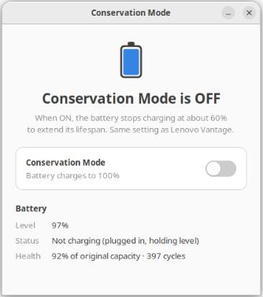
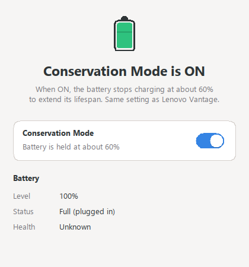

# IdeaPad Conservation Mode

A small app to turn **battery Conservation Mode** on or off on Lenovo IdeaPad laptops, on both **Windows** and **Linux**.
It changes the same firmware setting as Lenovo Vantage: when ON, the battery stops charging at about 60% to extend its lifespan.

| Linux | Windows |
|---|---|
|  |  |

## Download

Get the latest build from the [Releases](../../releases) page:

| OS | File | Requirements |
|---|---|---|
| Windows 10/11 (x64) | `ConservationMode-windows-x64.exe` | None. A single file with no installer and no admin rights. Lenovo Vantage or Lenovo Energy Management drivers must be installed (they are on stock Lenovo Windows installs). |
| Linux (x86_64) | `ConservationMode-linux-x86_64.tar.gz` | Only standard desktop libraries: glibc and GTK 3 (preinstalled on Ubuntu, Debian, Fedora, Mint, etc.) and the in-kernel `ideapad_laptop` driver. |
| Ubuntu / GNOME 45–50 | `ConservationMode-gnome-extension.tar.gz` | Quick Settings toggle only (also included in the Linux download). Needs `sudo` once to install the helper. |

## Usage

### Windows
Double-click `ConservationMode-windows-x64.exe`, then flip the switch.

### Linux
```sh
tar xzf ConservationMode-linux-x86_64.tar.gz
cd ConservationMode-linux-x86_64
./install.sh        # adds "Conservation Mode" to your app menu
```
Or run `./ConservationMode` directly without installing. Changing the setting asks for your password (through `pkexec`), because the kernel only lets root change it.

On Linux the app also keeps your choice after a restart. Turning the mode ON enables a small systemd service (`battery-conservation.service`) that re-applies it at boot, and turning it OFF disables that service.

### Ubuntu / GNOME Quick Settings toggle
A GNOME Shell extension (GNOME 45–50) adds a **Conservation** toggle to the Quick Settings menu (top-right, next to Wi-Fi, Bluetooth and Power Mode). It shows the current state each time the menu opens. When the mode is on, a battery icon appears in the top bar.

From the extracted Linux download, the `ConservationMode-gnome-extension.tar.gz` download, or a clone of this repository:
```sh
cd gnome-extension
sudo ./install-helper.sh   # once: root helper + polkit policy, so the toggle needs no password
./install.sh               # installs the extension for your user
```
On Wayland, log out and back in, then run:
```sh
gnome-extensions enable conservation-mode@conservationmode.github.io
```
The toggle runs `/usr/local/libexec/conservation-mode-helper on|off` through `pkexec`. The polkit policy lets the active local user run that one helper without a password. Like the app, the helper also turns the boot service on or off. To remove everything: `./install.sh uninstall` and `sudo ./install-helper.sh uninstall`.

### Command line
```sh
ConservationMode status | on | off | --version          # Linux
ConservationMode.exe status | on | off | --version      # Windows
```
On Windows there is also [`scripts/ConservationMode.ps1`](scripts/ConservationMode.ps1), a PowerShell version that needs no download.

## How it works

Both builds send the same commands to the laptop's embedded controller through the Lenovo `VPC2004` ACPI device:

| | Windows (`\\.\EnergyDrv`, IOCTL `0x831020F8`) | Linux (`ideapad_laptop` driver) |
|---|---|---|
| Turn on | `0x03` | write `1` to `/sys/bus/platform/drivers/ideapad_acpi/*/conservation_mode` |
| Turn off | `0x05` | write `0` |
| Read status | `0xFF`, bit 5 | read the same file |

> **Dual boot note:** Lenovo Vantage may re-apply its own saved choice when Windows starts, and the Linux boot service re-applies yours when Linux starts. Set the mode in each OS if you dual boot.

Tested on an IdeaPad 3 14ALC6. Other IdeaPad, Yoga and Legion models that have Conservation Mode in Vantage should work too.

## Building from source

On Ubuntu or Debian:
```sh
sudo apt install gcc libgtk-3-dev gcc-mingw-w64-x86-64
./build.sh
```
This builds `dist/ConservationMode` (Linux) and `dist/ConservationMode.exe` (Windows). GitHub Actions builds both on every push, and publishes a release when you push a `v*` tag:
```sh
git tag v1.0.0 && git push origin v1.0.0
```

```
src/conservation_mode_linux.c   Linux app (GTK 3)
src/conservation_mode_win.c     Windows app (Win32 + GDI+)
src/app.rc, src/app.manifest    Windows icon, version info and manifest
assets/                         App icon
scripts/ConservationMode.ps1    PowerShell command-line version
install.sh                      Linux per-user installer
gnome-extension/                GNOME Quick Settings toggle, root helper and polkit policy
```

## Disclaimer

Not affiliated with or endorsed by Lenovo. Use at your own risk.

## License

[MIT](LICENSE)
